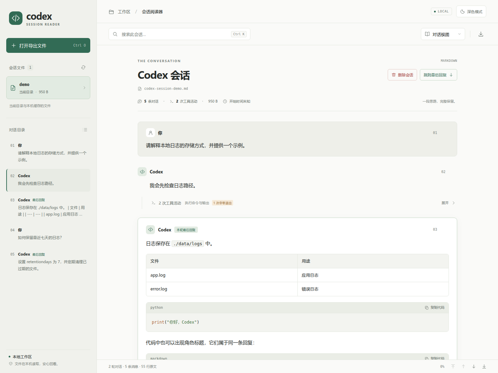
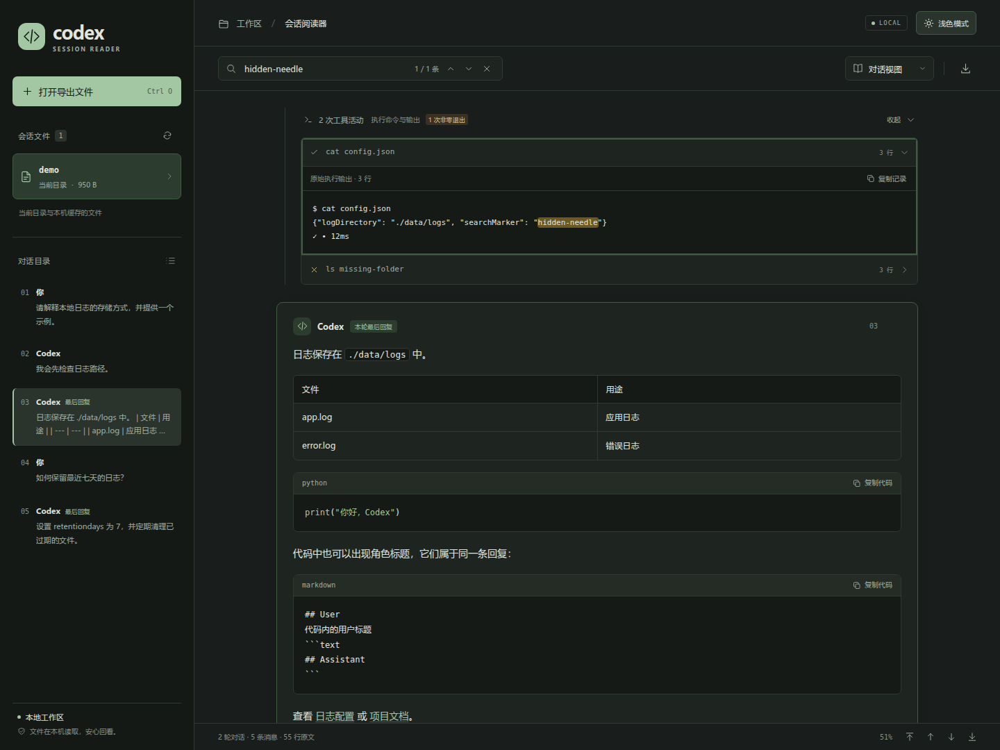

# 📖 Codex Session Web

本地运行的 Codex 会话阅读器，把 Markdown 导出文件还原为易读的用户与 Codex 对话，适合回看被大量工具输出打断的长会话。

- **易读的对话**：对话、精简和完整记录三种视图，连续工具活动默认折叠。
- **快速定位**：全文搜索覆盖工具输出，支持对话目录、按块跳转和直达最后回复。
- **按天归档**：Web 导入自动保存到 `sessions/YYYY-MM-DD/`，也可以通过命令行批量复制后刷新读取。
- **本地保存**：磁盘保存原始文件，浏览器缓存恢复上次会话；支持深浅主题和窄屏阅读。

## 🖼️ 界面预览

以下截图来自项目自带的合成示例会话。

**浅色模式 · 对话阅读与工具活动折叠**



<details>
<summary>查看深色模式：搜索并展开工具输出</summary>



</details>

## 🚀 快速开始

需要 **Node.js 20 或更新版本、npm 和 Git**。后台管理脚本适用于 **Linux / WSL**，需要 Bash 和 `flock`，Ubuntu 默认提供；也可以使用下面的 `npm start` 在前台运行。

```bash
git clone git@github.com:GaohaoZhou-ops/codex-session-web.git
cd codex-session-web
npm ci
./scripts/start.sh
```

浏览器打开 **http://127.0.0.1:4173**。在 WSL 中启动后，也可以用 Windows 浏览器访问 **http://localhost:4173**。

服务启动时会构建前端。页面会合并显示 `sessions/日期/` 中的会话、项目根目录中的 Codex 导出文件和本机缓存，并自动恢复上次打开的会话；没有会话时显示导入入口。

第一次使用，可以点击 **打开导出文件**，选择仓库中的 [示例会话](tests/fixtures/codex-session-demo.md)，也可以直接拖入自己的导出文件。

前台启动方式：

```bash
npm start            # 自动构建并启动服务，按 Ctrl+C 停止
```

## ⚙️ 服务管理

后台服务使用以下脚本管理：

```bash
./scripts/start.sh     # 构建前端，后台启动；关闭当前终端后继续运行
./scripts/status.sh    # 查看 PID、访问地址、健康状态和日志位置
./scripts/stop.sh      # 停止服务；重复停止也可正常退出
```

脚本可从任意工作目录调用，会自动定位到项目根目录。日志保存在 `.run/service.log`，进程和监听地址保存在 `.run/service.json`；这些运行文件不会提交到 Git。`status` 的退出码为 `0`（正常运行）、`3`（未运行）、`1`（异常）。

默认使用 `4173` 端口。重复或并发执行 `start` 会复用现有进程；即使后来改变 `PORT`，也不会为已有的受管实例重复开服务。更换端口时，先停止再启动：

```bash
./scripts/stop.sh
PORT=4321 ./scripts/start.sh
./scripts/status.sh    # 自动读取已记录的端口，无需再次指定 PORT
./scripts/stop.sh
```

启动失败时可查看 `tail -n 50 .run/service.log`。停止前会核对进程的启动时间和入口文件，过期 PID 记录不会导致其他进程被误停。也可以继续使用 `npm start` 在前台运行，按 `Ctrl+C` 停止；脚本能识别同一项目、同一端口通过 `npm start` 启动的服务，自定义端口且没有进程记录时需传入相同的 `PORT`。

## 🔎 阅读与检索

- 点击 **打开导出文件**，或将文件拖入窗口。支持 `.md`、`.markdown` 和 `.txt`，UTF-8 编码，单文件上限 20 MB；可以同时打开多个文件。成功打开的文件保存在浏览器本机缓存，并自动上传到本地服务的 `sessions/当天日期/` 目录，刷新或关闭页面后仍可再次打开。
- **会话文件**将目录文件和缓存文件按会话开始时间从新到旧统一排列，无法识别时间的文件放在最后；列表每批显示 50 个，点击 **显示更多会话** 继续查看，当前会话始终可见并保持时间顺序。刷新按钮重新扫描 `sessions/日期/` 和项目根目录，也会重新读取当前目录文件；同名文件内容变化后更新对应缓存。
- 浏览器缓存按文件内容去重：即使文件改名或修改时间不同，内容完全一致也会直接复用已有会话，不增加缓存正文副本。**同名文件的 SHA-256 变化时自动更新缓存**，释放不再使用的旧正文，列表保留该文件的最新版本；不同文件名仍在使用的旧正文会继续保留。批量导入多个同名文件时，以最后一个成功导入的版本为准。
- 点击左上角 **codex** 返回当前会话顶部，不重新加载页面，当前文件、搜索和阅读视图都会保留。
- 对话条数、工具活动数和文件大小后显示 **会话开始时间**，格式为 `2026年01月10日 13:23:43`，使用浏览器本地时区。时间从默认导出文件名中的 UUIDv7 会话 ID 提取；文件名不含可识别时间时显示“开始时间未知”。
- **对话目录**跳转到指定消息，页面上的 **跳到最后回复** 可直接查看最后一条 Codex 回复。
- 右下角依次提供 **回到顶部、上一块、下一块、到底部**。按块跳转以当前可见的消息、工具活动组和系统信息为单位，跳过隐藏内容，不自动展开折叠内容；在长块中向上跳转会先回到该块开头。
- 选中会话后，点击 **跳到最后回复** 左侧的 **删除会话**，在弹窗中确认后移除该会话及本机缓存。此操作无法撤销，原始导出文件保留；目录中已删除的文件版本在刷新后也会保持移除，手动重新导入原文件可以再次打开。删除后自动切换到相邻会话，全部删除后显示打开文件入口。
- **对话视图**显示用户和 Codex 消息，连续工具活动默认折叠。点击活动组，再点击某条命令即可查看原始输出。
- **精简视图**保留用户消息和每轮最后一条 Codex 回复；**完整记录**展开所有工具活动。
- **搜索**覆盖所有消息及折叠的工具输出，自动展开并高亮命中内容。计数按匹配的消息或活动条目计算。使用 `Enter` / `Shift+Enter` 切换下一条 / 上一条匹配，`Esc` 清除。
- Markdown 表格、列表、引用和代码块正常排版；常用语言有代码高亮。可以复制消息、代码或源码引用路径，也可以下载原始导出内容。
- 右上角通过太阳／月亮按钮切换深浅主题，自动记住选择；窄屏下也可直接切换，通过左上角打开侧栏。

| 快捷键 | 操作 |
| --- | --- |
| `Ctrl+O` / `⌘O` | 打开导出文件，可同时选择多个 |
| `Ctrl+K` / `⌘K` 或 `/` | 聚焦搜索 |
| `Enter` / `Shift+Enter` | 在搜索框中跳到下一条 / 上一条匹配 |
| `Esc` | 在搜索框中清除搜索 |

## 📂 按天保存与命令行导入

归档目录位于项目中的 `sessions/`，按服务所在机器的本地日期创建 `YYYY-MM-DD` 子文件夹：

```text
sessions/
  today.sh
  2026-10-25/
    codex-session-....md
  2026-10-26/
    codex-session-....md
```

Web 文件选择、拖拽和批量导入都自动使用收到上传请求时的日期；当天文件夹不存在时创建，存在时复用。保留原文件名和原始字节，包括 UTF-8 BOM 和换行格式。当天同名文件更新时替换该文件，内容相同则复用；不同日期的历史文件保留。网页始终显示原文件名，同名文件跨目录存在时取修改时间最新的一份，不额外展示日期层级。

在项目根目录运行以下命令即可批量导入：

```bash
session_day="$(./sessions/today.sh)" &&
  cp /path/to/exports/*.md "./sessions/$session_day/"
```

将 `/path/to/exports/` 换成实际导出目录。复制后刷新网页，或点击“会话文件”旁的刷新按钮，无需重启服务。

如果当前终端不在项目目录中，可以使用绝对路径：

```bash
archive_dir="/path/to/codex-session-web/sessions"
session_day="$("$archive_dir/today.sh")" &&
  cp /path/to/exports/*.md "$archive_dir/$session_day/"
```

`today.sh` 始终在脚本所在目录下创建日期文件夹，标准输出只有目录名和一个换行，例如 `2026-10-25`；当天目录已存在时直接返回，不存在时先创建。目录创建失败时返回非零退出码，并将错误写入标准错误。上面的 `&&` 确保目录准备成功后才执行复制。

归档扫描覆盖 `sessions/` 下所有 `YYYY-MM-DD` 子文件夹中的 `.md`、`.markdown`、`.txt` 文件，不跟随符号链接，也不继续递归更深的目录。根目录中的原有导出仍可读取；以前仅存在于浏览器缓存中的文件，重新导入后即可归档。删除会话仍只移除该浏览器中的记录和缓存，磁盘原文件保留。保存到磁盘失败时会通过原有错误提示告知，已打开的本机缓存仍可阅读，并可使用相同的导入入口重试。

## 💾 数据保存与文件格式

| 保存位置 | 内容 | 用途 |
| --- | --- | --- |
| `sessions/YYYY-MM-DD/` | Web 导入或命令行复制的原始文件 | 持久归档；其他浏览器也能通过同一服务读取 |
| 浏览器 IndexedDB | 会话索引、去重后的正文和删除记录 | 快速恢复、按需读取和本机列表管理 |
| 浏览器 localStorage | 主题、阅读视图、上次打开的会话标识 | 恢复个人阅读偏好 |

备份已归档会话时保存 `sessions/` 下的日期目录即可；根目录中单独保存的旧导出也应一并备份。历史上只存在于浏览器缓存中的文件，需要先通过下载或重新导入保存到磁盘。浏览器缓存不作为磁盘归档的替代品。

阅读解析和搜索在浏览器中完成；手动导入的文件会发送到本地 Node 服务，校验后写入按天归档的目录。成功导入的文件以及已打开的目录文件同时保存在浏览器的 **IndexedDB** 中，以原始字节的 SHA-256 指纹作为唯一标识；文件索引和正文分别存储，每份内容只保存一份。重复导入需要在本机读取所选文件以计算指纹，匹配后直接复用缓存，不重复写入缓存正文；原始 UTF-8 BOM 和换行格式会保留。

文件名索引用于定位要更新的会话，SHA-256 用于复用正文。同名更新在同一事务中写入新内容并清理旧内容；文件无效或缓存更新失败时保留原缓存。已导入的新版本优先于目录中未发生变化的旧副本，刷新页面后继续读取新缓存。旧版缓存会自动升级文件名索引。

启动时只读取轻量文件索引和上次打开的会话正文，其余会话在选中时才读取、解析，已切走会话的正文和解析结果不会继续堆积在页面内存中。目录扫描只读取文件元数据，兼容扫描项目根目录时额外读取文件头用于识别导出文件，不会预加载所有文件正文；恢复缓存会话无需等待扫描结束。工具输出仍按展开和搜索操作延迟渲染。

缓存属于当前浏览器的站点存储：请使用相同浏览器和访问地址，`localhost`、`127.0.0.1` 或不同端口的缓存互不共享。清除站点数据、隐私模式结束或浏览器回收存储可能移除缓存，请保留原始导出文件。缓存不可用或空间不足时，页面会显示提示，仍可在本页打开和切换文件。主题、阅读视图和上次选择的会话标识继续保存在 `localStorage` 中。

Node 服务负责静态资源、归档与根目录导出文件的读取，以及导入文件的本地归档，默认监听 `127.0.0.1`。上传只允许写入 `sessions/当天日期/` 下的普通文件，保留文件大小、编码和对话格式校验及同源限制。没有云端服务、统计代码或运行时 CDN 依赖，安装依赖后可以离线使用。Markdown 经过清理，远程图片不会自动加载；点击外部链接或“打开图片”时才会访问对应网站。本地源码链接用于复制路径，不会将电脑上的其他文件暴露给网页。

主要适配以下 `/export` 结构：

````markdown
# Codex conversation

## User

用户的提问。

## Assistant

Codex 的回复。

## Activity

    $ command
    command output
    ✓ • 12ms
````

同时识别 `System`、`Developer` 和 `Tool` 标题。支持 CRLF、UTF-8 BOM、反引号/波浪号围栏代码块和缩进代码；代码块中的角色标题不会被误切分。根目录自动扫描要求文件以 `# Codex conversation` 标题开头；没有这一总标题、但包含角色标题的文件可以手动打开，也可以直接放入 `sessions/日期/`。

导出正文未提供每条消息的可靠时间和回复通道；会话开始时间来自默认文件名中的会话 ID，不使用文件修改时间或缓存写入时间代替。“本轮最后回复”按每次用户提问后最后一条 Assistant 消息判断。对于 Markdown 原文中位于代码块外、完全同名的 `## User` / `## Assistant` 等标题，格式本身无法区别于消息边界。

## 🧪 开发与验证

```bash
PORT=4174 npm run dev  # 监听前端源码并自动构建，使用独立的开发端口
npm run build         # 生成 public/assets
npm test              # 解析、归档、上传、目录脚本与服务管理测试
```

开发时打开 **http://127.0.0.1:4174**，修改前端源码后刷新页面查看。修改服务端代码后需要重新启动开发进程。

浏览器交互测试：

```bash
npx playwright install chromium
npm run test:browser
```

Linux 如缺少 Chromium 运行库，可按 Playwright 的提示安装系统依赖（`npx playwright install-deps chromium`）。每个浏览器测试使用独立的临时归档目录、动态端口、浏览器存储和合成示例，覆盖上传落盘、命令行复制后刷新、缓存恢复、内容去重、按需读取、目录更新与存储失败，不修改真实导出文件；用户提供的示例存在时，也会验证其 40 条记录的解析与展示。

## ❓ 常见问题

| 问题 | 处理方式 |
| --- | --- |
| 刚克隆仓库，页面没有会话 | 打开 `tests/fixtures/codex-session-demo.md` 体验，或导入自己的 Markdown 导出文件。 |
| 复制文件后列表没有变化 | 刷新网页或点击文件列表刷新按钮；确认文件位于 `sessions/YYYY-MM-DD/` 这一层，扩展名受支持、大小不超过 20 MB，并且不是符号链接。 |
| 根目录的 Markdown 没被识别 | 根目录扫描要求文件以 `# Codex conversation` 开头；只有角色标题的导出可手动打开，或放到日期目录中。 |
| Web 提示保存到会话目录失败 | 检查 `sessions/` 和当天目录的写权限、磁盘空间，以及同名路径是否为普通文件；修复后通过原入口重新导入。 |
| 换了浏览器、地址或端口，缓存列表不同 | 浏览器缓存按站点隔离；磁盘归档仍可通过同一服务读取，旧的纯缓存会话需要重新导入。 |
| 删除会话后，磁盘文件仍存在 | 删除只影响当前浏览器的记录与缓存；原文件作为归档保留，其他浏览器仍可读取。 |
| 会话开始时间显示未知 | 时间从默认导出文件名中的 UUIDv7 提取；自定义文件名或无法识别的 ID 会显示未知，不影响阅读。 |
| 服务没有启动或端口被占用 | 先运行 `./scripts/status.sh`，再查看 `.run/service.log`；需要更换端口时按“服务管理”中的步骤停止后重启。 |

## 🗂️ 工程结构

```text
server.mjs           本地 HTTP 服务、上传接口、重复启动检测
src/session-files.js 按天归档、目录扫描与原始文件读写
src/parser.js        纯函数 Markdown 对话解析器
src/markdown.js      Markdown 渲染、代码高亮、内容清理
src/app.js           文件载入、搜索、导航与视图交互
src/session-cache.js IndexedDB 文件索引、正文缓存与内容去重
src/styles.css       响应式界面与深浅主题
public/              页面入口与本地构建产物
scripts/             start.sh / stop.sh / status.sh 服务管理，以及构建和开发脚本
sessions/            按天保存的会话文件，today.sh 创建并返回当天目录名
docs/images/         README 中的真实界面截图，内容来自合成示例
tests/               解析/服务测试、浏览器交互测试
```

`.gitignore` 排除依赖、构建产物、运行日志、浏览器测试报告和本地认证状态；`sessions/` 下的数据全部忽略，仅 `today.sh` 纳入版本控制；`codex-session-*` 导出文件（`.md`、`.markdown`、`.txt`、`.jsonl`）及 `rollout-*.jsonl` 在根目录和子目录中均被忽略，`tests/fixtures/` 下的对应测试样例可正常提交。
